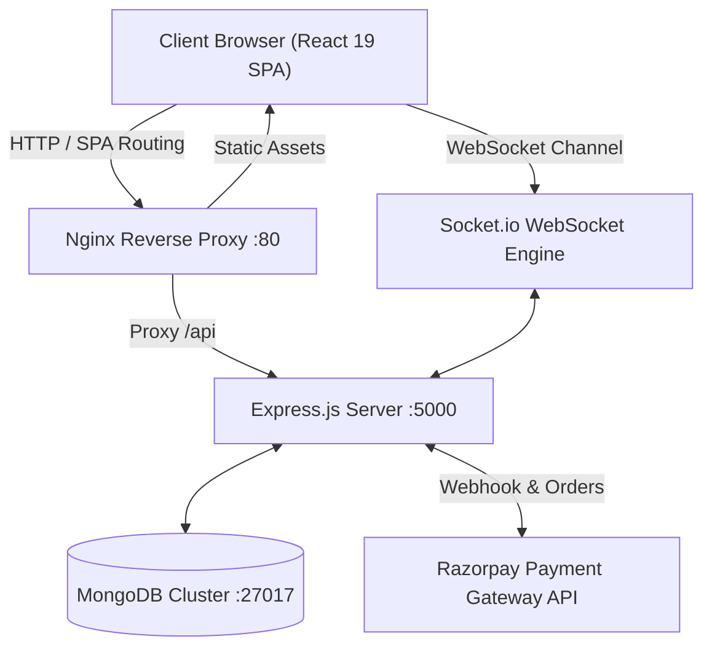

# 🏢 Society Maintenance Management System

<div align="center">


<p align="center">
  <b>A comprehensive, secure, real-time enterprise management portal for residential complexes and housing societies.</b>
</p>

</div>

---

> [!CAUTION]
> ### 🔒 CONFIDENTIAL & RESTRICTED ACCESS
> **This software and its source code are strictly private and proprietary.**
> Unauthorized access, copying, reverse engineering, redistribution, or deployment by unauthorized personnel is strictly prohibited. Access is restricted exclusively to authorized residential society management committee members and system administrators.

---

## 📋 Table of Contents
- [Key Features](#-key-features)
- [System Architecture](#-system-architecture)
- [Technology Stack](#-technology-stack)
- [Docker Production Setup](#-docker-production-setup)
- [Local Development](#-local-development)
- [Cloud Deployment (Render + Vercel + Atlas)](#-cloud-deployment)
- [CI/CD Pipelines](#-cicd-pipelines)
- [Environment Variables & Security](#-environment-variables--security)

---

## ✨ Key Features

- **💳 Automated Maintenance & Billing**:
  - Monthly maintenance calculation with automatic late fee/penalty support.
  - Multi-category resident classification (*Owner* vs. *Tenant* pricing).
  - Batch bill generation with scheduled cron jobs.
- **⚡ Real-Time Digital Payments**:
  - Razorpay payment gateway integration with dynamic QR generation.
  - Real-time order fulfillment & live room updates powered by **Socket.io**.
  - PDF receipt generation with downloadable receipts.
- **📢 Society Notice Board**:
  - Broadcast society announcements, emergency alerts, and meeting agendas.
- **🛠 Resident Complaints & Helpdesk**:
  - Categorized complaint ticketing (Plumbing, Electrical, General) with live status tracking.
- **📊 Financial & Expense Tracking**:
  - Comprehensive income vs. expenditure tracking with graphical analytics (Chart.js).
- **🚪 Visitor Management System**:
  - Gate check-in, tracking visitor purpose, flat number, and vehicle entry logs.

---

## 🏛 System Architecture



---

## 🛠 Technology Stack

| Layer | Technologies |
| :--- | :--- |
| **Frontend** | React 19, TypeScript, Bootstrap 5, Lucide Icons, Chart.js, Framer Motion, Axios |
| **Backend** | Node.js (ES Modules), Express.js, Socket.io, Node-Cron, Mongoose, JWT, Bcrypt |
| **Database** | MongoDB 7.0 / MongoDB Atlas |
| **Containerization** | Docker, Docker Compose, Nginx (Alpine) |
| **CI/CD** | GitHub Actions (Automated CI & CD to GHCR), GitLab CI |

---

## 🐳 Docker Production Setup

### Prerequisites
- Install **[Docker Desktop](https://www.docker.com/products/docker-desktop/)** (version 20+ with Docker Compose v2+).

### One-Command Deployment

1. **Configure Environment File**:
   ```bash
   cp .env.example .env
   ```
2. **Build and Start All Containers**:
   ```bash
   docker compose up --build -d
   ```
3. **Check Container Health**:
   ```bash
   docker compose ps
   ```

### Ports & Access
* **Frontend Web Application**: [http://localhost:3000](http://localhost:3000)
* **Backend API Gateway**: [http://localhost:5000](http://localhost:5000)
* **Backend Health Check**: [http://localhost:5000/health](http://localhost:5000/health)
* **MongoDB Database**: `mongodb://localhost:27017/societyDB`

### Operational Commands
```bash
# View live aggregated logs
docker compose logs -f

# View backend logs specifically
docker compose logs -f backend

# Safely shut down all containers
docker compose down

# Shut down and wipe database volume (clean reset)
docker compose down -v
```

---

## 💻 Local Development

### 1. Backend Server
```bash
cd backend
npm install
npm run dev
```
*Backend runs on port `5000` with hot-reloading.*

### 2. Frontend Client
```bash
cd frontend
npm install --legacy-peer-deps
npm start
```
*Frontend runs on port `3000` and automatically proxies to the backend.*

---

## ☁ Cloud Deployment

The repository is pre-configured for **$0 zero-cost cloud deployment**:

### 1. Database: MongoDB Atlas (M0 Free Tier)
* Create a free cluster on [MongoDB Atlas](https://www.mongodb.com/cloud/atlas).
* Set **Network Access** to `0.0.0.0/0` (Allow from Anywhere).
* Copy the connection URI:
  ```text
  mongodb+srv://<user>:<password>@cluster.mongodb.net/societyDB?retryWrites=true&w=majority
  ```

### 2. Backend: Render (Docker Web Service)
* Create a new Web Service on [Render](https://render.com) connected to your GitHub repo.
* **Root Directory**: `backend`
* **Runtime**: `Docker`
* Configure environment variables (`MONGODB_URI`, `JWT_SECRET`, `PORT=5000`, `RAZORPAY_KEY_ID`, etc.).

### 3. Frontend: Vercel (Global Edge Network)
* Import repo in [Vercel](https://vercel.com).
* **Root Directory**: `frontend`
* Set Environment Variable:
  * `REACT_APP_API_URL` = `https://your-render-backend.onrender.com`
* Pre-configured with [`frontend/vercel.json`](frontend/vercel.json) for seamless single-page application routing.

---

## 🚀 CI/CD Pipelines

### 1. Continuous Integration (`.github/workflows/ci.yml`)
* Automatically tests every `push` and `pull_request` to `main`, `master`, and `develop`.
* Boots a real MongoDB service container to test database connectivity.
* Runs backend integrity checks and React/TypeScript production builds.
* Validates Dockerfile syntax and container compilation.

### 2. Continuous Deployment (`.github/workflows/cd.yml`)
* Builds production-ready images for frontend and backend on every merge to `main`.
* Publishes versioned images to **GitHub Container Registry (GHCR)**.
* Supports automated SSH remote server triggers for zero-downtime rolling updates.

---

## 🔐 Environment Variables & Security

> [!WARNING]
> Never commit actual `.env` files into source control. All `.env` files are excluded by `.gitignore`.

| Variable | Description | Default / Example |
| :--- | :--- | :--- |
| `PORT` | Backend HTTP port | `5000` |
| `MONGODB_URI` | Mongo connection string | `mongodb://mongodb:27017/societyDB` |
| `JWT_SECRET` | Secret key for signing session tokens | *Generate a 64-char random hex* |
| `RAZORPAY_KEY_ID` | Razorpay Merchant Key ID | `rzp_test_...` |
| `RAZORPAY_KEY_SECRET` | Razorpay Merchant Secret Key | `...` |
| `RAZORPAY_WEB_SECRET` | Razorpay Webhook Signature Secret | `...` |
| `VPA_ID` | Society UPI ID for static QR code | `society@upi` |
| `REACT_APP_API_URL` | Base API URL consumed by frontend | `http://localhost:5000` |

---

## 📜 Security & Access Control

* All database operations are secured behind **JWT authentication tokens**.
* Role-based access control enforces strict separation between **`user`** (residents) and **`admin`** (committee).
* Docker containers execute under unprivileged user privileges (`node`) with Alpine-hardened base images.
* All passwords are encrypted with salted **Bcrypt** rounds.

---

<div align="center">
  <sub>Property of Residential Society Management Committee. All rights reserved.</sub>
</div>
